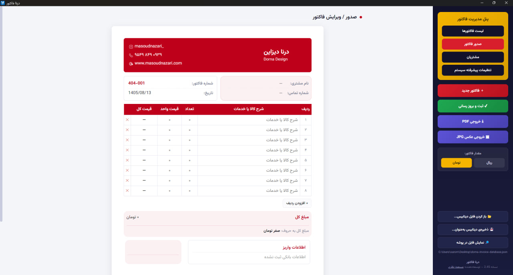

# Dorna Invoice | درنا فاکتور

### Professional Persian Invoice Management Software for Windows

**Dorna Invoice** is a Persian desktop application designed to simplify invoice creation, customer management, payment tracking, and professional invoice generation.

Built for businesses, freelancers, and professionals who need a simple and reliable way to create, manage, and print invoices.

<kbd>Windows 10 / 11</kbd> · <kbd>64-bit</kbd> · <kbd>Offline</kbd> · <kbd>Persian RTL</kbd>

---

## ✨ Key Features

### Invoice Management
- Create professional Persian invoices.
- Automatic invoice numbering with customizable prefixes.
- Jalali (Persian) calendar with editable dates.
- Add, edit, and remove products or services.
- Flexible invoice rows.
- Automatic subtotal, discount, and final amount calculation.
- Support for Iranian Toman and Rial currencies.

### Customer Management
- Save and manage customer information.
- Automatic customer information suggestions.
- Search invoices by customer name, invoice number, or amount.
- View, edit, and manage previously created invoices.

### Payment Tracking
- Record multiple payments for each invoice.
- Support for partial and installment payments.
- Automatic calculation of total payments and outstanding balances.
- Display outstanding balances in Persian words.
- Filter invoices by payment status:
  - Paid
  - Partially Paid
  - Unpaid

### Custom Branding
- Customize invoice brand colors.
- Add your company logo and signature.
- Configure business name in Persian and English.
- Add contact details, website, and social media information.
- Manage multiple bank accounts.
- Customize customer information fields.

### Export & Printing
- Export invoices as PDF in A4 format.
- Export high-resolution PNG images at 300 DPI.
- Print invoices directly through your system's PDF viewer.
- Professional Persian typography and right-to-left layout.

### Offline & Local Data
- Works without an internet connection.
- Stores invoice and customer information locally.
- Uses a JSON-based database.
- Import and open existing database files.
- Save database backups to a location of your choice.
- Transfer your business data between computers using database backup files.

---

## 📦 Download

Get the latest version from the official GitHub Releases page.

**[Download Dorna Invoice – Latest Release](../../releases/latest)**

Available Windows editions and download options are listed in each release.

Depending on the release, downloads may include:

| Edition | Distribution | Description |
|---|---|---|
| Simple | Installer | Standard Windows installation |
| Simple | Portable | Run without installation |
| Payments | Installer | Windows installation with payment tracking |
| Payments | Portable | Portable version with payment tracking |

### Installer vs. Portable

**Installer**
- Standard Windows installation wizard.
- Choose your preferred installation directory.
- Suitable for regular use on one computer.

**Portable**
- No traditional installation required.
- Run the application directly.
- Convenient for use on different computers.

---

## 🚀 Getting Started

1. Visit the [Releases page](../../releases/latest).
2. Download your preferred Windows version.
3. For the Installer edition, run the Setup file and follow the installation steps.
4. For the Portable edition, run the downloaded executable.
5. Configure your business information, logo, invoice appearance, and bank accounts.
6. Start creating professional invoices.

---

## 🔐 Privacy & Data Protection

Dorna Invoice is designed with an offline-first approach.

- No online account is required.
- Invoice and customer data are stored locally on your computer.
- The application uses a local JSON database.
- You can manually export and back up your database.
- Your business information is not intended to be uploaded to an external service.

**Important:** Your database may contain sensitive financial and customer information. Keep regular backups and never share your database file publicly.

---

## 💻 System Requirements

| Requirement | Specification |
|---|---|
| Operating System | Windows 10 / Windows 11 |
| Architecture | 64-bit (x64) |
| Internet | Not required for normal operation |
| Application Type | Desktop Application |

---

## 🖼️ Screenshots

### Main Interface

### Invoice Preview

### Invoice Archive

### Application Settings

---

## 🛠️ Technology

- Electron
- JavaScript
- HTML5
- CSS3
- JSON
- Vazirmatn Typography

---

## 👨‍💻 Developer

**Masoud Nazari**

Visual Designer · Digital Product Creator

Developed under **Dorna Design**.

- Website: [masoudnazari.com](https://masoudnazari.com)
- GitHub: [@Lord-Masoud](https://github.com/Lord-Masoud)

---

## 📄 Copyright & License

Copyright © 2026 Masoud Nazari – Dorna Design.

Dorna Invoice is proprietary software. All rights reserved.

This repository is intended for product information and distribution of official executable releases.

The application's source code is not included. No permission to modify, redistribute, resell, or commercially exploit the software is granted by making this repository public.

For licensing, commercial use, or distribution inquiries, please contact the developer through the official website.

---

**Dorna Invoice — Simple, Professional, Offline.**
